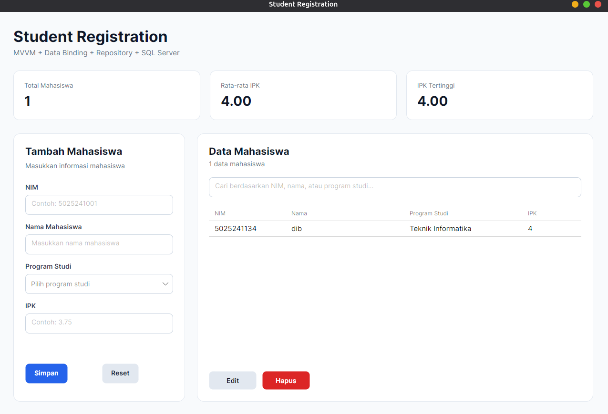
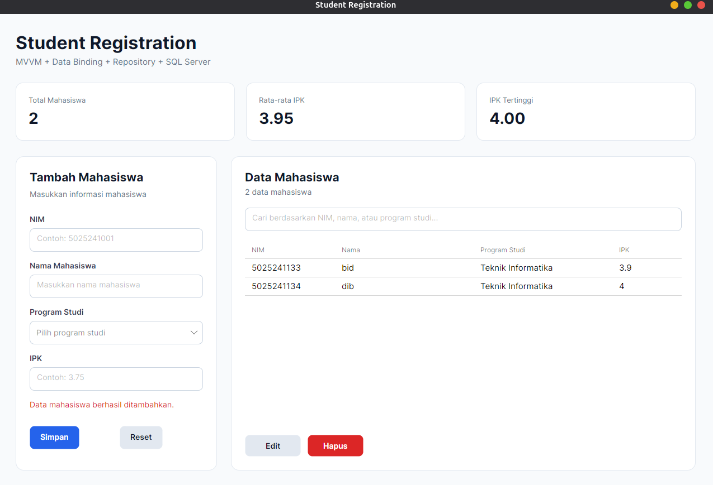
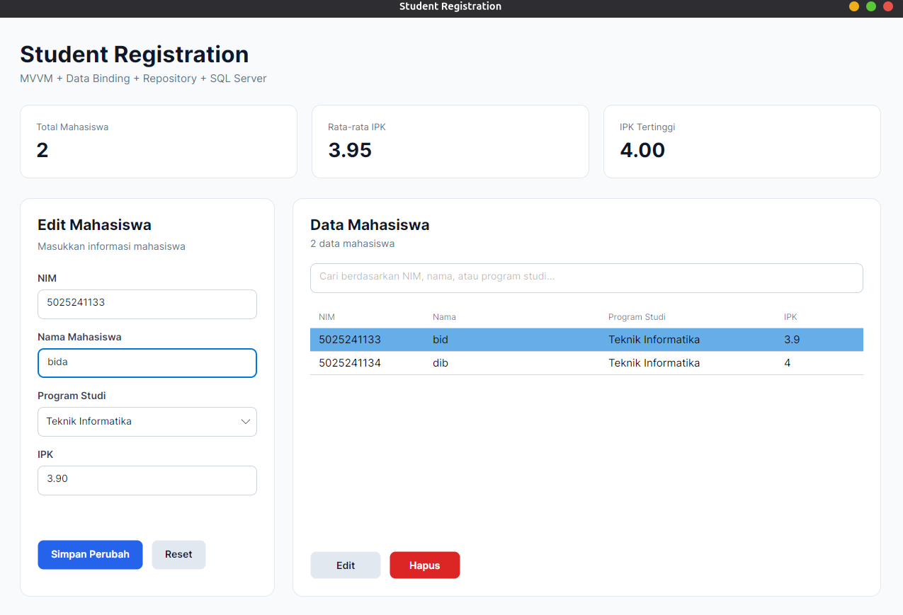
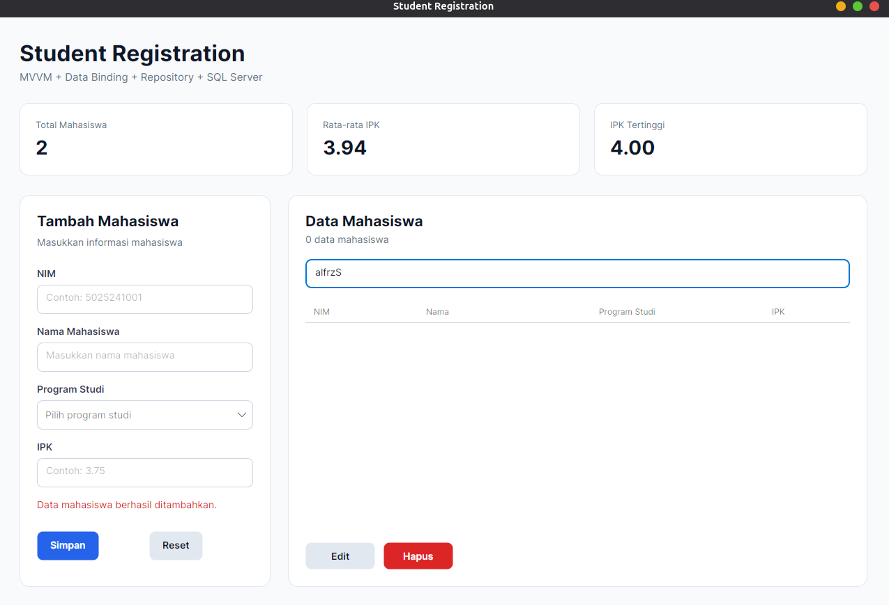
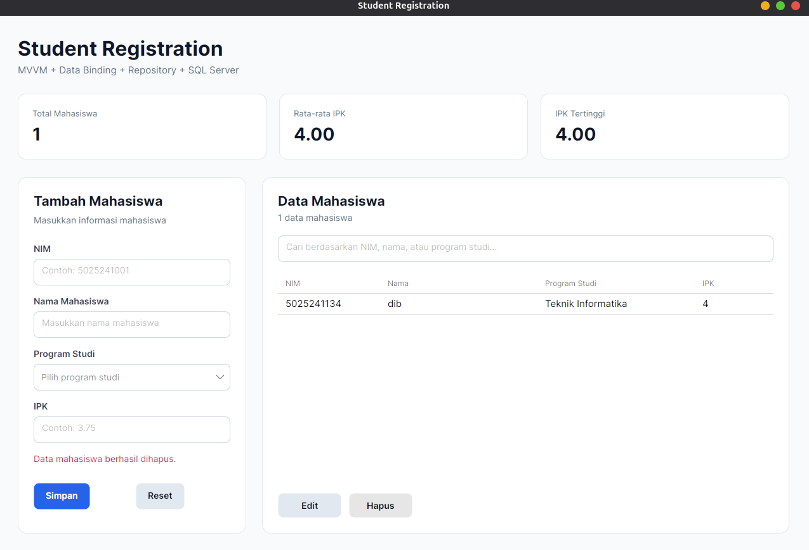
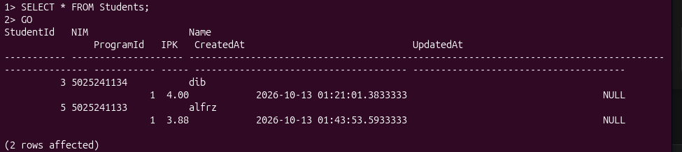
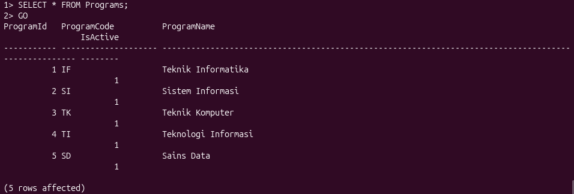

# Implementasi .NET Framework & C# untuk Pembuatan Aplikasi WPF (Student Registration Dashboard) dengan SQL Server + ADO.NET

Nama: Muhammad Abid Baihaqi Al Faridzi

NRP: 5025241133

Prodi: Teknik Informatika

Mata Kuliah: Pemrograman Berbasis Kerangka Kerja

Kelas: D

---

## Program Student Registration Desktop Dashboard

Program ini merupakan aplikasi berbasis **Desktop GUI** yang dibangun menggunakan bahasa pemrograman **C#**, platform **.NET 10**, dan framework **Avalonia UI**. Avalonia digunakan agar aplikasi desktop dapat dikembangkan dan dijalankan secara cross-platform, termasuk pada sistem operasi Ubuntu.

Project ini merupakan pengembangan dari Student Registration Dashboard sebelumnya. Arsitektur aplikasi menggunakan **MVVM (Model-View-ViewModel)**, **Data Binding**, **Command**, dan **Repository Pattern**, tetapi penyimpanan data diubah dari SQLite + Entity Framework Core menjadi **SQL Server + ADO.NET** menggunakan package `Microsoft.Data.SqlClient`.

Aplikasi digunakan untuk mengelola data mahasiswa berupa **NIM, Nama, Program Studi, dan IPK**. Program Studi tidak lagi disimpan sebagai data hardcoded pada ViewModel, tetapi diambil dari tabel `Programs` pada SQL Server. Data mahasiswa disimpan pada tabel `Students`, sedangkan informasi nama program studi diperoleh melalui relasi `ProgramId`.

Program memiliki beberapa fitur utama, yaitu:

- Menambahkan data mahasiswa.
- Menampilkan data mahasiswa pada `DataGrid`.
- Mengedit data mahasiswa.
- Menghapus data mahasiswa.
- Melakukan pencarian berdasarkan NIM, nama, atau program studi.
- Validasi input NIM, nama, program studi, dan IPK.
- Validasi NIM agar tidak terjadi duplikasi.
- Dashboard statistik berupa total mahasiswa, rata-rata IPK, dan IPK tertinggi.
- Implementasi MVVM dan Data Binding.
- Implementasi Command menggunakan `CommunityToolkit.Mvvm`.
- Implementasi Repository Pattern.
- Integrasi SQL Server menggunakan ADO.NET.
- Menggunakan `SqlConnection`, `SqlCommand`, dan `SqlDataReader`.
- Mengambil daftar Program Studi dari database.
- Menyimpan data secara persisten pada SQL Server.
- Menjalankan SQL Server melalui Docker pada Ubuntu.
- Custom UI Styling menggunakan AXAML.

---

## Setup Project Directory

Buat project Avalonia:

```bash
dotnet new avalonia.app -o StudentRegistrationApp
cd StudentRegistrationApp
```

Tambahkan package yang dibutuhkan:

```bash
dotnet add package CommunityToolkit.Mvvm
dotnet add package Avalonia.Controls.DataGrid --version 12.1.2
dotnet add package Microsoft.Data.SqlClient
```

Restore dependency:

```bash
dotnet restore
```

---

## Setup Docker pada Ubuntu

Install Docker:

```bash
sudo apt update
sudo apt install -y docker.io
sudo apt install util-linux-extra
```

Aktifkan Docker:

```bash
sudo systemctl enable --now docker
```

Tambahkan user ke group Docker:

```bash
sudo usermod -aG docker $USER
newgrp docker
```

Tes Docker:

```bash
docker run --rm hello-world
```

Download image SQL Server:

```bash
docker pull mcr.microsoft.com/mssql/server:2022-latest
```

Jalankan SQL Server:

```bash
docker run -d \
  --name pbkk-sqlserver \
  -e "ACCEPT_EULA=Y" \
  -e "MSSQL_SA_PASSWORD=StrongPass12345678" \
  -p 1433:1433 \
  -v student_sql_data:/var/opt/mssql \
  mcr.microsoft.com/mssql/server:2022-latest
```

Konfigurasi tersebut menggunakan:

```text
Container : pbkk-sqlserver
Server    : localhost,1433
Username  : sa
Password  : StrongPass12345678
Database  : StudentRegistrationDB
```

Volume `student_sql_data` digunakan agar database tetap tersimpan walaupun container dihentikan.

```bash
docker exec -i pbkk-sqlserver   /opt/mssql-tools18/bin/sqlcmd   -S localhost   -U sa   -P 'StrongPass12345678'   -C   < schema/database.sql
```

Command di atas digunakan untuk membuat database `StudentRegistrationDB` beserta tabel `Programs` dan `Students`.

Cek container:

```bash
docker ps
```

Untuk penggunaan berikutnya, SQL Server cukup dijalankan kembali dengan:

```bash
docker start pbkk-sqlserver
```

Untuk menghentikan SQL Server:

```bash
docker stop pbkk-sqlserver
```

---

## Struktur Project

```text
StudentRegistrationApp/
├── Data/
│   └── DatabaseConfig.cs
├── Models/
│   ├── Mahasiswa.cs
│   └── ProgramStudi.cs
├── Repositories/
│   ├── IMahasiswaRepository.cs
│   ├── IProgramRepository.cs
│   ├── MahasiswaRepository.cs
│   └── ProgramRepository.cs
├── ViewModels/
│   ├── ViewModelBase.cs
│   └── MainWindowViewModel.cs
├── Views/
│   ├── MainWindow.axaml
│   └── MainWindow.axaml.cs
├── schema/
│   └── database.sql
├── App.axaml
├── App.axaml.cs
├── Program.cs
├── StudentRegistrationApp.csproj
└── app.manifest
```

Struktur project memisahkan tanggung jawab aplikasi berdasarkan fungsi masing-masing layer.

- `Models` menyimpan struktur object data.
- `Views` menangani tampilan aplikasi.
- `ViewModels` menangani state, validation, search, statistik, dan Command.
- `Repositories` menangani akses data ke SQL Server.
- `Data` menyimpan konfigurasi koneksi database.
- `App.axaml.cs` menghubungkan Repository, ViewModel, dan View.

---

## Konfigurasi File `StudentRegistrationApp.csproj`

```xml
<Project Sdk="Microsoft.NET.Sdk">
  <PropertyGroup>
    <OutputType>WinExe</OutputType>
    <TargetFramework>net10.0</TargetFramework>
    <Nullable>enable</Nullable>
    <ApplicationManifest>app.manifest</ApplicationManifest>
  </PropertyGroup>

  <ItemGroup>
    <PackageReference Include="Avalonia" Version="12.1.2" />
    <PackageReference Include="Avalonia.Controls.DataGrid" Version="12.1.2" />
    <PackageReference Include="Avalonia.Desktop" Version="12.1.2" />
    <PackageReference Include="Avalonia.Themes.Fluent" Version="12.1.2" />
    <PackageReference Include="Avalonia.Fonts.Inter" Version="12.1.2" />

    <PackageReference Include="AvaloniaUI.DiagnosticsSupport" Version="2.2.3">
      <IncludeAssets Condition="'$(Configuration)' != 'Debug'">None</IncludeAssets>
      <PrivateAssets Condition="'$(Configuration)' != 'Debug'">All</PrivateAssets>
    </PackageReference>

    <PackageReference Include="CommunityToolkit.Mvvm" Version="8.4.2" />
    <PackageReference Include="Microsoft.Data.SqlClient" Version="7.1.1" />
  </ItemGroup>
</Project>
```

`CommunityToolkit.Mvvm` digunakan untuk implementasi MVVM melalui `ObservableObject`, `ObservableProperty`, dan `RelayCommand`.

`Microsoft.Data.SqlClient` digunakan sebagai provider ADO.NET untuk menghubungkan aplikasi C# dengan SQL Server.

---

## Edit File `Program.cs`

```csharp
using Avalonia;

using System;

namespace StudentRegistrationApp;

class Program
{
    [STAThread]
    public static void Main(string[] args) =>
        BuildAvaloniaApp()
            .StartWithClassicDesktopLifetime(args);

    public static AppBuilder BuildAvaloniaApp() =>
        AppBuilder
            .Configure<App>()
            .UsePlatformDetect()
#if DEBUG
            .WithDeveloperTools()
#endif
            .WithInterFont()
            .LogToTrace();
}
```

File `Program.cs` merupakan entry point aplikasi. Method `Main()` menjalankan aplikasi menggunakan `StartWithClassicDesktopLifetime()`.

---

## Edit File `App.axaml`

```xml
<Application
    xmlns="https://github.com/avaloniaui"
    xmlns:x="http://schemas.microsoft.com/winfx/2006/xaml"
    x:Class="StudentRegistrationApp.App"
    RequestedThemeVariant="Light">

    <Application.Styles>
        <FluentTheme />

        <StyleInclude
            Source="avares://Avalonia.Controls.DataGrid/Themes/Fluent.xaml" />
    </Application.Styles>

</Application>
```

`App.axaml` mengatur theme global aplikasi. `RequestedThemeVariant="Light"` digunakan agar tampilan tetap konsisten pada Ubuntu.

---

## Edit File `App.axaml.cs`

```csharp
using Avalonia;
using Avalonia.Controls.ApplicationLifetimes;
using Avalonia.Markup.Xaml;

using StudentRegistrationApp.Repositories;
using StudentRegistrationApp.ViewModels;
using StudentRegistrationApp.Views;

namespace StudentRegistrationApp
{
    public partial class App : Application
    {
        public override void Initialize(){
            AvaloniaXamlLoader.Load(this);
        }

        public override void OnFrameworkInitializationCompleted(){
            if (
                ApplicationLifetime
                is IClassicDesktopStyleApplicationLifetime desktop
            ){
                IMahasiswaRepository mahasiswaRepository =
                    new MahasiswaRepository();

                IProgramRepository programRepository =
                    new ProgramRepository();

                MainWindowViewModel viewModel =
                    new MainWindowViewModel(
                        mahasiswaRepository,
                        programRepository
                    );

                desktop.MainWindow = new MainWindow{
                    DataContext = viewModel
                };
            }

            base.OnFrameworkInitializationCompleted();
        }
    }
}
```

File ini melakukan dependency injection sederhana secara manual.

`MahasiswaRepository` dan `ProgramRepository` dibuat terlebih dahulu, kemudian diberikan ke `MainWindowViewModel`. ViewModel selanjutnya dijadikan `DataContext` dari `MainWindow`.

---

## Edit File `Data/DatabaseConfig.cs`

```csharp
namespace StudentRegistrationApp.Data
{
    public static class DatabaseConfig
    {
        public const string ConnectionString =
            "Server=localhost,1433;" +
            "Database=StudentRegistrationDB;" +
            "User Id=sa;" +
            "Password=StrongPass12345678;" +
            "TrustServerCertificate=True;";
    }
}
```

File `DatabaseConfig.cs` menyimpan connection string SQL Server.

Konfigurasi yang digunakan:

```text
Server   = localhost,1433
Database = StudentRegistrationDB
User     = sa
Password = StrongPass12345678
```

`TrustServerCertificate=True` digunakan pada environment development lokal agar koneksi dapat dilakukan tanpa validasi sertifikat eksternal.

---

## Schema SQL Server

Database yang digunakan adalah:

```text
StudentRegistrationDB
```

Database memiliki dua tabel utama:

```text
StudentRegistrationDB
├── Programs
└── Students
```

Contoh schema:

```sql
IF DB_ID('StudentRegistrationDB') IS NULL
BEGIN
    CREATE DATABASE StudentRegistrationDB;
END;
GO

USE StudentRegistrationDB;
GO

IF OBJECT_ID('Programs', 'U') IS NULL
BEGIN
    CREATE TABLE Programs (
        ProgramId INT IDENTITY(1,1) PRIMARY KEY,
        ProgramCode VARCHAR(20) NOT NULL UNIQUE,
        ProgramName VARCHAR(100) NOT NULL,
        IsActive BIT NOT NULL DEFAULT 1
    );
END;
GO

IF OBJECT_ID('Students', 'U') IS NULL
BEGIN
    CREATE TABLE Students (
        StudentId INT IDENTITY(1,1) PRIMARY KEY,
        NIM VARCHAR(20) NOT NULL UNIQUE,
        Name VARCHAR(100) NOT NULL,
        ProgramId INT NOT NULL,
        IPK DECIMAL(3,2) NOT NULL,
        CreatedAt DATETIME2 NOT NULL DEFAULT GETDATE(),
        UpdatedAt DATETIME2 NULL,

        CONSTRAINT FK_Students_Programs
            FOREIGN KEY (ProgramId)
            REFERENCES Programs(ProgramId),

        CONSTRAINT CK_Students_IPK
            CHECK (IPK >= 0 AND IPK <= 4)
    );
END;
GO
```

Isi awal tabel `Programs`:

```sql
IF NOT EXISTS (
    SELECT 1
    FROM Programs
)
BEGIN
    INSERT INTO Programs (
        ProgramCode,
        ProgramName
    )
    VALUES
    ('IF', 'Teknik Informatika'),
    ('SI', 'Sistem Informasi'),
    ('TK', 'Teknik Komputer'),
    ('TI', 'Teknologi Informasi'),
    ('SD', 'Sains Data');
END;
GO
```

---

## Edit File `Models/Mahasiswa.cs`

```csharp
using System;

namespace StudentRegistrationApp.Models
{
    public class Mahasiswa
    {
        public int Id { get; set; }
        public string NIM { get; set; } = "";
        public string Nama { get; set; } = "";
        public int ProgramId { get; set; }
        public string Prodi { get; set; } = "";
        public double IPK { get; set; }
        public DateTime CreatedAt { get; set; }
        public DateTime? UpdatedAt { get; set; }
    }
}
```

Model `Mahasiswa` merepresentasikan data dari tabel `Students` sekaligus hasil JOIN dengan tabel `Programs`.

`ProgramId` menyimpan foreign key program studi, sedangkan `Prodi` digunakan untuk menampung nama program studi dari hasil JOIN.

---

## Edit File `Models/ProgramStudi.cs`

```csharp
namespace StudentRegistrationApp.Models
{
    public class ProgramStudi
    {
        public int ProgramId { get; set; }
        public string ProgramCode { get; set; } = "";
        public string ProgramName { get; set; } = "";
        public bool IsActive { get; set; }

        public override string ToString(){
            return ProgramName;
        }
    }
}
```

Model `ProgramStudi` merepresentasikan data tabel `Programs`.

Method `ToString()` mengembalikan `ProgramName`, sehingga object `ProgramStudi` dapat langsung ditampilkan pada `ComboBox`.

---

## Edit File `Repositories/IMahasiswaRepository.cs`

```csharp
using StudentRegistrationApp.Models;

using System.Collections.Generic;

namespace StudentRegistrationApp.Repositories
{
    public interface IMahasiswaRepository
    {
        List<Mahasiswa> GetAll();
        Mahasiswa? GetById(int id);
        void Add(Mahasiswa mahasiswa);
        void Update(Mahasiswa mahasiswa);
        void Delete(Mahasiswa mahasiswa);
        bool NIMExists(string nim);
        bool NIMExists(string nim, int exceptId);
    }
}
```

Interface `IMahasiswaRepository` mendefinisikan operasi data mahasiswa yang dibutuhkan ViewModel.

---

## Edit File `Repositories/IProgramRepository.cs`

```csharp
using StudentRegistrationApp.Models;

using System.Collections.Generic;

namespace StudentRegistrationApp.Repositories
{
    public interface IProgramRepository
    {
        List<ProgramStudi> GetAllActive();
    }
}
```

Interface `IProgramRepository` menyediakan kontrak untuk mengambil Program Studi yang aktif dari SQL Server.

---

## Edit File `Repositories/ProgramRepository.cs`

```csharp
using Microsoft.Data.SqlClient;

using StudentRegistrationApp.Data;
using StudentRegistrationApp.Models;

using System.Collections.Generic;

namespace StudentRegistrationApp.Repositories
{
    public class ProgramRepository : IProgramRepository
    {
        public List<ProgramStudi> GetAllActive(){
            List<ProgramStudi> programs = new();

            const string sql = """
                SELECT
                    ProgramId,
                    ProgramCode,
                    ProgramName,
                    IsActive
                FROM Programs
                WHERE IsActive = 1
                ORDER BY ProgramName;
            """;

            using SqlConnection connection =
                new SqlConnection(DatabaseConfig.ConnectionString);

            using SqlCommand command =
                new SqlCommand(sql, connection);

            connection.Open();

            using SqlDataReader reader =
                command.ExecuteReader();

            while (reader.Read()){
                programs.Add(new ProgramStudi{
                    ProgramId = reader.GetInt32(reader.GetOrdinal("ProgramId")),
                    ProgramCode = reader.GetString(reader.GetOrdinal("ProgramCode")),
                    ProgramName = reader.GetString(reader.GetOrdinal("ProgramName")),
                    IsActive = reader.GetBoolean(reader.GetOrdinal("IsActive"))
                });
            }

            return programs;
        }
    }
}
```

`ProgramRepository` menggunakan ADO.NET untuk membaca data Program Studi.

---

## Edit File `Repositories/MahasiswaRepository.cs`

```csharp
using Microsoft.Data.SqlClient;

using StudentRegistrationApp.Data;
using StudentRegistrationApp.Models;

using System;
using System.Collections.Generic;

namespace StudentRegistrationApp.Repositories
{
    public class MahasiswaRepository : IMahasiswaRepository
    {
        public List<Mahasiswa> GetAll(){
            List<Mahasiswa> mahasiswaList = new();

            const string sql = """
                SELECT
                    s.StudentId,
                    s.NIM,
                    s.Name,
                    s.ProgramId,
                    p.ProgramName,
                    s.IPK,
                    s.CreatedAt,
                    s.UpdatedAt
                FROM Students s
                INNER JOIN Programs p
                    ON s.ProgramId = p.ProgramId
                ORDER BY s.StudentId;
            """;

            using SqlConnection connection =
                new SqlConnection(DatabaseConfig.ConnectionString);

            using SqlCommand command =
                new SqlCommand(sql, connection);

            connection.Open();

            using SqlDataReader reader =
                command.ExecuteReader();

            while (reader.Read()){
                mahasiswaList.Add(new Mahasiswa{
                    Id = reader.GetInt32(reader.GetOrdinal("StudentId")),
                    NIM = reader.GetString(reader.GetOrdinal("NIM")),
                    Nama = reader.GetString(reader.GetOrdinal("Name")),
                    ProgramId = reader.GetInt32(reader.GetOrdinal("ProgramId")),
                    Prodi = reader.GetString(reader.GetOrdinal("ProgramName")),
                    IPK = Convert.ToDouble(reader.GetDecimal(reader.GetOrdinal("IPK"))),
                    CreatedAt = reader.GetDateTime(reader.GetOrdinal("CreatedAt")),
                    UpdatedAt = reader.IsDBNull(reader.GetOrdinal("UpdatedAt"))
                        ? null
                        : reader.GetDateTime(reader.GetOrdinal("UpdatedAt"))
                });
            }

            return mahasiswaList;
        }

        public Mahasiswa? GetById(int id){
            const string sql = """
                SELECT
                    s.StudentId,
                    s.NIM,
                    s.Name,
                    s.ProgramId,
                    p.ProgramName,
                    s.IPK,
                    s.CreatedAt,
                    s.UpdatedAt
                FROM Students s
                INNER JOIN Programs p
                    ON s.ProgramId = p.ProgramId
                WHERE s.StudentId = @StudentId;
            """;

            using SqlConnection connection =
                new SqlConnection(DatabaseConfig.ConnectionString);

            using SqlCommand command =
                new SqlCommand(sql, connection);

            command.Parameters.AddWithValue("@StudentId", id);

            connection.Open();

            using SqlDataReader reader =
                command.ExecuteReader();

            if (!reader.Read()){
                return null;
            }

            return new Mahasiswa{
                Id = reader.GetInt32(reader.GetOrdinal("StudentId")),
                NIM = reader.GetString(reader.GetOrdinal("NIM")),
                Nama = reader.GetString(reader.GetOrdinal("Name")),
                ProgramId = reader.GetInt32(reader.GetOrdinal("ProgramId")),
                Prodi = reader.GetString(reader.GetOrdinal("ProgramName")),
                IPK = Convert.ToDouble(reader.GetDecimal(reader.GetOrdinal("IPK"))),
                CreatedAt = reader.GetDateTime(reader.GetOrdinal("CreatedAt")),
                UpdatedAt = reader.IsDBNull(reader.GetOrdinal("UpdatedAt"))
                    ? null
                    : reader.GetDateTime(reader.GetOrdinal("UpdatedAt"))
            };
        }

        public void Add(Mahasiswa mahasiswa){
            const string sql = """
                INSERT INTO Students (
                    NIM,
                    Name,
                    ProgramId,
                    IPK
                )
                VALUES (
                    @NIM,
                    @Name,
                    @ProgramId,
                    @IPK
                );
            """;

            using SqlConnection connection =
                new SqlConnection(DatabaseConfig.ConnectionString);

            using SqlCommand command =
                new SqlCommand(sql, connection);

            command.Parameters.AddWithValue("@NIM", mahasiswa.NIM);
            command.Parameters.AddWithValue("@Name", mahasiswa.Nama);
            command.Parameters.AddWithValue("@ProgramId", mahasiswa.ProgramId);
            command.Parameters.AddWithValue("@IPK", mahasiswa.IPK);

            connection.Open();

            command.ExecuteNonQuery();
        }

        public void Update(Mahasiswa mahasiswa){
            const string sql = """
                UPDATE Students
                SET
                    NIM = @NIM,
                    Name = @Name,
                    ProgramId = @ProgramId,
                    IPK = @IPK,
                    UpdatedAt = GETDATE()
                WHERE StudentId = @StudentId;
            """;

            using SqlConnection connection =
                new SqlConnection(DatabaseConfig.ConnectionString);

            using SqlCommand command =
                new SqlCommand(sql, connection);

            command.Parameters.AddWithValue("@StudentId", mahasiswa.Id);
            command.Parameters.AddWithValue("@NIM", mahasiswa.NIM);
            command.Parameters.AddWithValue("@Name", mahasiswa.Nama);
            command.Parameters.AddWithValue("@ProgramId", mahasiswa.ProgramId);
            command.Parameters.AddWithValue("@IPK", mahasiswa.IPK);

            connection.Open();

            command.ExecuteNonQuery();
        }

        public void Delete(Mahasiswa mahasiswa){
            const string sql = """
                DELETE FROM Students
                WHERE StudentId = @StudentId;
            """;

            using SqlConnection connection =
                new SqlConnection(DatabaseConfig.ConnectionString);

            using SqlCommand command =
                new SqlCommand(sql, connection);

            command.Parameters.AddWithValue("@StudentId", mahasiswa.Id);

            connection.Open();

            command.ExecuteNonQuery();
        }

        public bool NIMExists(string nim){
            const string sql = """
                SELECT COUNT(*)
                FROM Students
                WHERE NIM = @NIM;
            """;

            using SqlConnection connection =
                new SqlConnection(DatabaseConfig.ConnectionString);

            using SqlCommand command =
                new SqlCommand(sql, connection);

            command.Parameters.AddWithValue("@NIM", nim);

            connection.Open();

            int count = Convert.ToInt32(command.ExecuteScalar());

            return count > 0;
        }

        public bool NIMExists(string nim, int exceptId){
            const string sql = """
                SELECT COUNT(*)
                FROM Students
                WHERE
                    NIM = @NIM
                    AND StudentId != @StudentId;
            """;

            using SqlConnection connection =
                new SqlConnection(DatabaseConfig.ConnectionString);

            using SqlCommand command =
                new SqlCommand(sql, connection);

            command.Parameters.AddWithValue("@NIM", nim);
            command.Parameters.AddWithValue("@StudentId", exceptId);

            connection.Open();

            int count = Convert.ToInt32(command.ExecuteScalar());

            return count > 0;
        }
    }
}
```

`MahasiswaRepository` merupakan data access layer untuk tabel `Students`.

Repository menggunakan:

```csharp
using Microsoft.Data.SqlClient;
```

Operasi `GetAll()` menjalankan query JOIN:

```sql
SELECT
    s.StudentId,
    s.NIM,
    s.Name,
    s.ProgramId,
    p.ProgramName,
    s.IPK,
    s.CreatedAt,
    s.UpdatedAt
FROM Students s
INNER JOIN Programs p
    ON s.ProgramId = p.ProgramId
ORDER BY s.StudentId;
```

Query tersebut mengambil data mahasiswa sekaligus nama Program Studi.

Connection dibuat menggunakan:

```csharp
using SqlConnection connection =
    new SqlConnection(DatabaseConfig.ConnectionString);

using SqlCommand command =
    new SqlCommand(sql, connection);

connection.Open();

using SqlDataReader reader =
    command.ExecuteReader();
```

Hasil query kemudian dipetakan menjadi object `Mahasiswa`.

Operasi CRUD yang tersedia:

```text
GetAll()
GetById()
Add()
Update()
Delete()
NIMExists()
```

Method `Add()` menggunakan `INSERT` dan `ExecuteNonQuery()`.

Method `Update()` menggunakan `UPDATE` dan memperbarui `UpdatedAt` menggunakan `GETDATE()`.

Method `Delete()` menggunakan `DELETE`.

Method `NIMExists()` menggunakan `SELECT COUNT(*)` dan `ExecuteScalar()` untuk memeriksa apakah NIM telah digunakan.

Semua query menggunakan parameter seperti:

```csharp
command.Parameters.AddWithValue("@NIM", mahasiswa.NIM);
```

agar nilai input tidak langsung digabungkan ke string query.

---

## Edit File `ViewModels/ViewModelBase.cs`

```csharp
using CommunityToolkit.Mvvm.ComponentModel;

namespace StudentRegistrationApp.ViewModels
{
    public partial class ViewModelBase : ObservableObject
    {
    }
}
```

`ObservableObject` menyediakan implementasi `INotifyPropertyChanged` yang dibutuhkan Data Binding.

---

## Edit File `ViewModels/MainWindowViewModel.cs`

```csharp
using CommunityToolkit.Mvvm.ComponentModel;
using CommunityToolkit.Mvvm.Input;

using StudentRegistrationApp.Models;
using StudentRegistrationApp.Repositories;

using System;
using System.Collections.ObjectModel;
using System.Globalization;
using System.Linq;

namespace StudentRegistrationApp.ViewModels
{
    public partial class MainWindowViewModel : ViewModelBase
    {
        private readonly IMahasiswaRepository _mahasiswaRepository;
        private readonly IProgramRepository _programRepository;

        private Mahasiswa? mahasiswaSedangDiedit;

        public ObservableCollection<Mahasiswa> DaftarMahasiswa { get; } = new();
        public ObservableCollection<Mahasiswa> MahasiswaTampil { get; } = new();
        public ObservableCollection<ProgramStudi> DaftarProdi { get; } = new();

        [ObservableProperty]
        private string nim = "";

        [ObservableProperty]
        private string nama = "";

        [ObservableProperty]
        private ProgramStudi? prodiTerpilih;

        [ObservableProperty]
        private string ipk = "";

        [ObservableProperty]
        private string keywordSearch = "";

        [ObservableProperty]
        private Mahasiswa? mahasiswaTerpilih;

        [ObservableProperty]
        private string formTitle = "Tambah Mahasiswa";

        [ObservableProperty]
        private string simpanButtonText = "Simpan";

        [ObservableProperty]
        private string pesan = "";

        public int TotalMahasiswa =>
            DaftarMahasiswa.Count;

        public double RataRataIPK =>
            DaftarMahasiswa.Count == 0
                ? 0
                : DaftarMahasiswa.Average(m => m.IPK);

        public double IPKTertinggi =>
            DaftarMahasiswa.Count == 0
                ? 0
                : DaftarMahasiswa.Max(m => m.IPK);

        public string JumlahData =>
            $"{MahasiswaTampil.Count} data mahasiswa";

        public MainWindowViewModel(
            IMahasiswaRepository mahasiswaRepository,
            IProgramRepository programRepository
        ){
            _mahasiswaRepository = mahasiswaRepository;
            _programRepository = programRepository;

            LoadProgramStudi();
            LoadData();
        }

        partial void OnKeywordSearchChanged(string value){
            RefreshData();
        }

        [RelayCommand]
        private void Simpan(){
            string nimInput = Nim.Trim();
            string namaInput = Nama.Trim();

            if (string.IsNullOrWhiteSpace(nimInput)){
                Pesan = "NIM harus diisi.";
                return;
            }

            if (string.IsNullOrWhiteSpace(namaInput)){
                Pesan = "Nama mahasiswa harus diisi.";
                return;
            }

            if (ProdiTerpilih == null){
                Pesan = "Program studi harus dipilih.";
                return;
            }

            if (!CobaParseIPK(Ipk, out double nilaiIpk)){
                Pesan = "IPK harus berupa angka.";
                return;
            }

            if (nilaiIpk < 0 || nilaiIpk > 4){
                Pesan = "IPK harus berada antara 0 sampai 4.";
                return;
            }

            if (mahasiswaSedangDiedit == null){
                if (_mahasiswaRepository.NIMExists(nimInput)){
                    Pesan = "NIM tersebut sudah terdaftar.";
                    return;
                }

                Mahasiswa mahasiswaBaru = new Mahasiswa{
                    NIM = nimInput,
                    Nama = namaInput,
                    ProgramId = ProdiTerpilih.ProgramId,
                    Prodi = ProdiTerpilih.ProgramName,
                    IPK = nilaiIpk
                };

                _mahasiswaRepository.Add(mahasiswaBaru);

                Pesan = "Data mahasiswa berhasil ditambahkan.";
            }
            else{
                if (
                    _mahasiswaRepository.NIMExists(
                        nimInput,
                        mahasiswaSedangDiedit.Id
                    )
                ){
                    Pesan = "NIM sudah digunakan mahasiswa lain.";
                    return;
                }

                mahasiswaSedangDiedit.NIM = nimInput;
                mahasiswaSedangDiedit.Nama = namaInput;
                mahasiswaSedangDiedit.ProgramId = ProdiTerpilih.ProgramId;
                mahasiswaSedangDiedit.Prodi = ProdiTerpilih.ProgramName;
                mahasiswaSedangDiedit.IPK = nilaiIpk;

                _mahasiswaRepository.Update(mahasiswaSedangDiedit);

                Pesan = "Data mahasiswa berhasil diperbarui.";
            }

            LoadData();
            ResetForm();
        }

        [RelayCommand]
        private void Edit(){
            if (MahasiswaTerpilih == null){
                Pesan = "Pilih mahasiswa yang ingin diedit.";
                return;
            }

            mahasiswaSedangDiedit = MahasiswaTerpilih;

            Nim = mahasiswaSedangDiedit.NIM;
            Nama = mahasiswaSedangDiedit.Nama;
            Ipk = mahasiswaSedangDiedit.IPK.ToString(
                "0.00",
                CultureInfo.InvariantCulture
            );

            ProdiTerpilih = DaftarProdi.FirstOrDefault(
                p => p.ProgramId == mahasiswaSedangDiedit.ProgramId
            );

            FormTitle = "Edit Mahasiswa";
            SimpanButtonText = "Simpan Perubahan";
            Pesan = "";
        }

        [RelayCommand]
        private void Hapus(){
            if (MahasiswaTerpilih == null){
                Pesan = "Pilih mahasiswa yang ingin dihapus.";
                return;
            }

            _mahasiswaRepository.Delete(MahasiswaTerpilih);

            MahasiswaTerpilih = null;

            LoadData();

            Pesan = "Data mahasiswa berhasil dihapus.";
        }

        [RelayCommand]
        private void Reset(){
            ResetForm();
            Pesan = "";
        }

        private void LoadProgramStudi(){
            DaftarProdi.Clear();

            foreach (ProgramStudi program in _programRepository.GetAllActive()){
                DaftarProdi.Add(program);
            }
        }

        private void LoadData(){
            DaftarMahasiswa.Clear();

            foreach (Mahasiswa mahasiswa in _mahasiswaRepository.GetAll()){
                DaftarMahasiswa.Add(mahasiswa);
            }

            RefreshData();
            RefreshStatistics();
        }

        private void ResetForm(){
            Nim = "";
            Nama = "";
            ProdiTerpilih = null;
            Ipk = "";

            mahasiswaSedangDiedit = null;

            FormTitle = "Tambah Mahasiswa";
            SimpanButtonText = "Simpan";
        }

        private void RefreshData(){
            MahasiswaTampil.Clear();

            string keyword =
                KeywordSearch.Trim().ToLowerInvariant();

            var hasil = DaftarMahasiswa.AsEnumerable();

            if (!string.IsNullOrWhiteSpace(keyword)){
                hasil = hasil.Where(
                    m =>
                        m.NIM.ToLowerInvariant().Contains(keyword)
                        ||
                        m.Nama.ToLowerInvariant().Contains(keyword)
                        ||
                        m.Prodi.ToLowerInvariant().Contains(keyword)
                );
            }

            foreach (Mahasiswa mahasiswa in hasil){
                MahasiswaTampil.Add(mahasiswa);
            }

            OnPropertyChanged(nameof(JumlahData));
        }

        private void RefreshStatistics(){
            OnPropertyChanged(nameof(TotalMahasiswa));
            OnPropertyChanged(nameof(RataRataIPK));
            OnPropertyChanged(nameof(IPKTertinggi));
            OnPropertyChanged(nameof(JumlahData));
        }

        private bool CobaParseIPK(string? input, out double ipk){
            ipk = 0;

            if (string.IsNullOrWhiteSpace(input)){
                return false;
            }

            if (
                double.TryParse(
                    input,
                    NumberStyles.Float,
                    CultureInfo.CurrentCulture,
                    out ipk
                )
            ){
                return true;
            }

            if (
                double.TryParse(
                    input,
                    NumberStyles.Float,
                    CultureInfo.InvariantCulture,
                    out ipk
                )
            ){
                return true;
            }

            string alternatif = input.Replace(',', '.');

            return double.TryParse(
                alternatif,
                NumberStyles.Float,
                CultureInfo.InvariantCulture,
                out ipk
            );
        }
    }
}
```

`MainWindowViewModel` merupakan pusat state dan logic aplikasi.

Repository yang digunakan:

```csharp
private readonly IMahasiswaRepository _mahasiswaRepository;
private readonly IProgramRepository _programRepository;
```

Collection yang digunakan:

```csharp
public ObservableCollection<Mahasiswa> DaftarMahasiswa { get; } = new();
public ObservableCollection<Mahasiswa> MahasiswaTampil { get; } = new();
public ObservableCollection<ProgramStudi> DaftarProdi { get; } = new();
```

Program Studi dimuat dari database:

```csharp
private void LoadProgramStudi(){
    DaftarProdi.Clear();

    foreach (ProgramStudi program in _programRepository.GetAllActive()){
        DaftarProdi.Add(program);
    }
}
```

Data mahasiswa dimuat melalui Repository:

```csharp
private void LoadData(){
    DaftarMahasiswa.Clear();

    foreach (Mahasiswa mahasiswa in _mahasiswaRepository.GetAll()){
        DaftarMahasiswa.Add(mahasiswa);
    }

    RefreshData();
    RefreshStatistics();
}
```

Property `[ObservableProperty]` digunakan untuk state form:

```csharp
[ObservableProperty]
private string nim = "";

[ObservableProperty]
private string nama = "";

[ObservableProperty]
private ProgramStudi? prodiTerpilih;

[ObservableProperty]
private string ipk = "";
```

Command dibuat menggunakan `[RelayCommand]`, yaitu:

```text
SimpanCommand
EditCommand
HapusCommand
ResetCommand
```

Saat menyimpan mahasiswa baru, ViewModel membuat object:

```csharp
Mahasiswa mahasiswaBaru = new Mahasiswa{
    NIM = nimInput,
    Nama = namaInput,
    ProgramId = ProdiTerpilih.ProgramId,
    Prodi = ProdiTerpilih.ProgramName,
    IPK = nilaiIpk
};
```

kemudian memanggil:

```csharp
_mahasiswaRepository.Add(mahasiswaBaru);
```

ViewModel tidak menjalankan query SQL secara langsung. Semua operasi SQL didelegasikan kepada Repository.

---

## Edit File `Views/MainWindow.axaml.cs`

```csharp
using Avalonia.Controls;

namespace StudentRegistrationApp.Views
{
    public partial class MainWindow : Window
    {
        public MainWindow(){
            InitializeComponent();
        }
    }
}
```

---

## Implementasi Data Binding pada `Views/MainWindow.axaml`

View menggunakan:

```xml
x:DataType="vm:MainWindowViewModel"
```

untuk menentukan tipe ViewModel yang digunakan.

Binding input:

```xml
<TextBox
    Text="{Binding Nim}"/>

<TextBox
    Text="{Binding Nama}"/>

<ComboBox
    ItemsSource="{Binding DaftarProdi}"
    SelectedItem="{Binding ProdiTerpilih}"/>

<TextBox
    Text="{Binding Ipk}"/>
```

Program Studi pada `ComboBox` berasal dari tabel `Programs` melalui `ProgramRepository`.

Binding Command:

```xml
<Button
    Content="{Binding SimpanButtonText}"
    Command="{Binding SimpanCommand}"/>

<Button
    Content="Reset"
    Command="{Binding ResetCommand}"/>

<Button
    Content="Edit"
    Command="{Binding EditCommand}"/>

<Button
    Content="Hapus"
    Command="{Binding HapusCommand}"/>
```

Binding `DataGrid`:

```xml
<DataGrid
    ItemsSource="{Binding MahasiswaTampil}"
    SelectedItem="{Binding MahasiswaTerpilih}"
    AutoGenerateColumns="False"
    IsReadOnly="True">

    <DataGrid.Columns>
        <DataGridTextColumn
            Header="NIM"
            Binding="{Binding NIM}"/>

        <DataGridTextColumn
            Header="Nama"
            Binding="{Binding Nama}"/>

        <DataGridTextColumn
            Header="Program Studi"
            Binding="{Binding Prodi}"/>

        <DataGridTextColumn
            Header="IPK"
            Binding="{Binding IPK}"/>
    </DataGrid.Columns>
</DataGrid>
```

Binding statistik:

```xml
<TextBlock
    Text="{Binding TotalMahasiswa}"/>

<TextBlock
    Text="{Binding RataRataIPK, StringFormat='{}{0:F2}'}"/>

<TextBlock
    Text="{Binding IPKTertinggi, StringFormat='{}{0:F2}'}"/>
```

Dengan Data Binding, View tidak perlu membaca atau mengubah control secara langsung melalui code-behind.

---

## Implementasi ADO.NET

ADO.NET digunakan pada Repository sebagai penghubung antara aplikasi dengan SQL Server.

Tiga object utama yang digunakan:

```text
SqlConnection
SqlCommand
SqlDataReader
```

### `SqlConnection`

Digunakan untuk membuka koneksi ke SQL Server.

```csharp
using SqlConnection connection =
    new SqlConnection(DatabaseConfig.ConnectionString);

connection.Open();
```

### `SqlCommand`

Digunakan untuk menjalankan query SQL.

```csharp
using SqlCommand command =
    new SqlCommand(sql, connection);
```

### `SqlDataReader`

Digunakan untuk membaca hasil query `SELECT`.

```csharp
using SqlDataReader reader =
    command.ExecuteReader();

while (reader.Read()){
    ...
}
```

Untuk operasi `INSERT`, `UPDATE`, dan `DELETE`, Repository menggunakan:

```csharp
command.ExecuteNonQuery();
```

Sedangkan pengecekan NIM menggunakan:

```csharp
command.ExecuteScalar();
```   

---

## How to Run (In Ubuntu)

Pastikan .NET tersedia:

```bash
dotnet --version
```

Pastikan Docker tersedia:

```bash
docker --version
```

Jalankan SQL Server:

```bash
docker start pbkk-sqlserver
```

Cek status:

```bash
docker ps
```

Jika database belum dibuat, jalankan schema:

```bash
docker exec -i pbkk-sqlserver \
  /opt/mssql-tools18/bin/sqlcmd \
  -S localhost \
  -U sa \
  -P 'StrongPass12345678' \
  -C \
  < database.sql
```

Restore dependency:

```bash
dotnet restore
```

Build project:

```bash
dotnet build
```

Jalankan aplikasi:

```bash
dotnet run
```

Untuk menghentikan SQL Server:

```bash
docker stop pbkk-sqlserver
```

Untuk menjalankan kembali pada penggunaan berikutnya:

```bash
docker start pbkk-sqlserver
dotnet run
```

---

## Program Documentation

### 1. Dashboard Statistik

Dashboard menampilkan Total Mahasiswa, Rata-rata IPK, dan IPK Tertinggi.



### 2. Tambah Mahasiswa



### 3. Edit Mahasiswa




### 4. Search Mahasiswa



### 5. Hapus Mahasiswa



### 6. SQL Server Database




