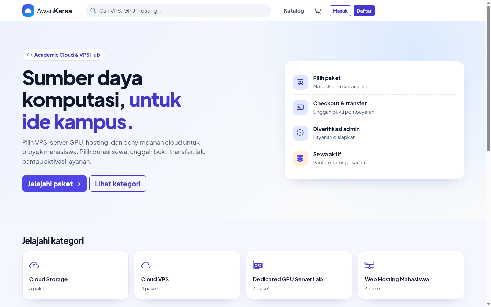
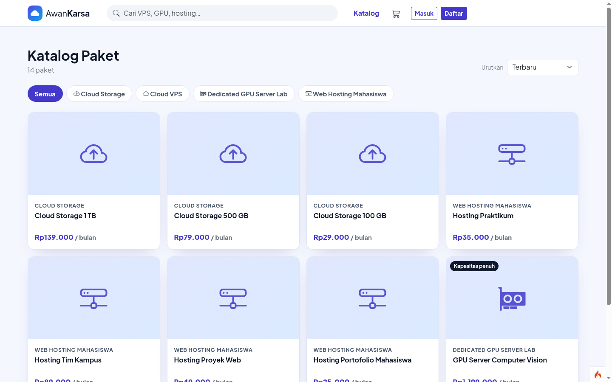
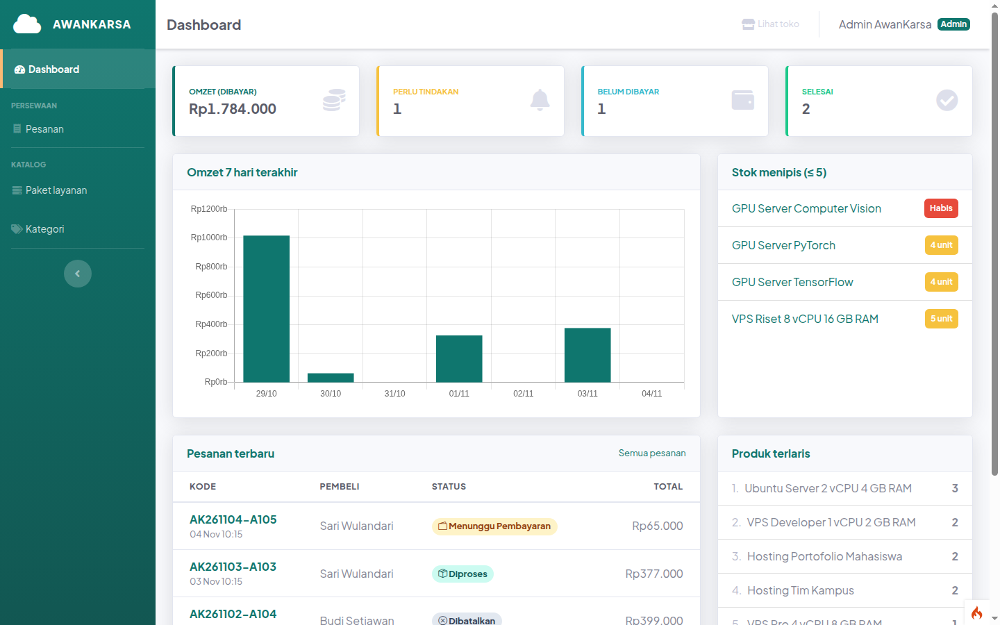
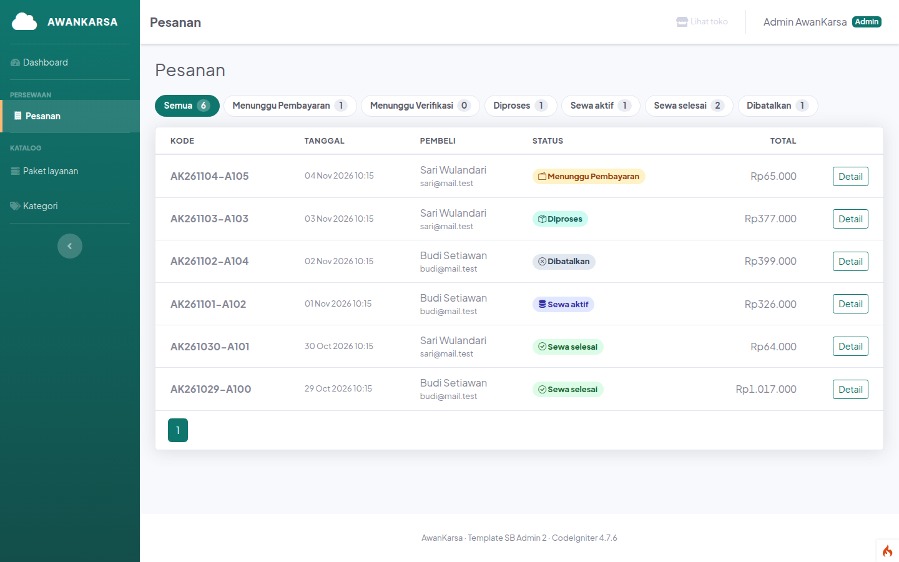

# AwanKarsa — Academic Cloud & VPS Hub

**Mata kuliah:** Pemrograman Berbasis Kerangka Kerja (PBKK) · **Nama:** Muhammad Abid Baihaqi Al Faridzi · **NRP:** 5025241133 · **Kelas:** D

## Deskripsi

AwanKarsa adalah aplikasi simulasi persewaan sumber daya komputasi untuk proyek mahasiswa, termasuk VPS, server GPU, web hosting, dan cloud storage.

## Fitur dan hak akses

| Peran | Fitur |
|---|---|
| Pengunjung | Melihat dan mencari katalog paket, memeriksa kapasitas, serta mengisi keranjang. |
| Pelanggan | Mendaftar dan masuk, memilih durasi sewa, checkout, mengunggah bukti transfer, serta memantau pesanan. |
| Administrator | Mengelola paket dan kategori, memverifikasi pembayaran, mengaktifkan layanan, serta mengakhiri sewa. |

Harga paket berlaku per unit untuk 30 hari. Durasi checkout adalah 1–12 bulan dan berlaku untuk seluruh paket dalam satu pesanan. Periode dimulai ketika admin mengaktifkan layanan. Kapasitas dikembalikan ketika pesanan dibatalkan atau admin mengakhiri sewa.

**Batas simulasi:** rekening dan referensi layanan adalah data demo. Pembayaran, penyediaan server, serta akhir sewa tidak diproses otomatis; admin mengelola status secara manual.

## Struktur database

Tabel utama adalah `users`, `kategori`, `produk`, `orders`, dan `order_items`. Pesanan menyimpan durasi dan tanggal periode sewa, sementara item menyimpan harga dan jumlah paket saat checkout. Data pesanan lama dipertahankan setelah migrasi.

## Akun demo

| Peran | Email | Password |
|---|---|---|
| Administrator | `admin@awankarsa.test` | `admin123` |
| Pelanggan | `budi@mail.test` | `pembeli123` |

Kredensial ini berasal dari data demo dan berlaku jika data akun belum diubah.

## Teknologi dan prasyarat

- PHP 8.2 atau lebih baru dengan ekstensi yang diperlukan CodeIgniter, termasuk `intl`, `mbstring`, `mysqli`, `curl`, dan `xml`.
- Composer dan MySQL; proyek menggunakan CodeIgniter 4 dan Bootstrap.
- Ekstensi `gd` diperlukan untuk fitur pengolahan gambar jika digunakan.

## Instalasi dan menjalankan

1. Buat database MySQL kosong bernama `awankarsa` dan pastikan pengguna MySQL memiliki akses ke database tersebut.
2. Masuk ke folder `AwanKarsa` dan instal dependensi:

   ```bash
   cd "T06_Framework CodeIgniter/AwanKarsa"
   composer install
   ```

3. Jika `.env` belum ada, salin `.env.example` menjadi `.env`. Atur koneksi database dan URL sesuai lingkungan lokal; jangan menimpa `.env` yang sudah dikonfigurasi.

   ```ini
   CI_ENVIRONMENT = development
   app.baseURL = 'http://localhost:8082/'
   app.indexPage = ''
   database.default.hostname = 127.0.0.1
   database.default.database = awankarsa
   database.default.username = USER_MYSQL
   database.default.password = PASSWORD_MYSQL
   database.default.DBDriver = MySQLi
   database.default.port = 3306
   database.default.DBPrefix = ''
   ```

4. Jalankan migrasi dan data demo pada **database baru yang masih kosong**:

   ```bash
   php spark project:setup --seed
   ```

   Untuk database yang sudah berisi data, jalankan `php spark project:setup` tanpa `--seed`; perintah tersebut juga menerapkan migrasi periode sewa.

5. Jalankan aplikasi:

   ```bash
   php spark serve --host 127.0.0.1 --port 8082
   ```

   Buka <http://localhost:8082/> di browser. Hentikan server dengan `Ctrl+C`.

## Pengujian

```bash
php spark routes
vendor/bin/phpunit
```

Jalankan perintah tersebut dari direktori proyek. Sebagian pengujian database mungkin memerlukan konfigurasi dan data MySQL khusus.

## Keamanan

Akses pelanggan dan admin dibatasi melalui filter autentikasi dan peran. Formulir menggunakan perlindungan CSRF; bukti pembayaran disimpan di direktori nonpublik dan hanya dapat dilihat oleh pemilik pesanan atau admin.

## Tampilan aplikasi

### Beranda



### Katalog paket komputasi



### Dashboard administrator



### Pengelolaan pesanan


