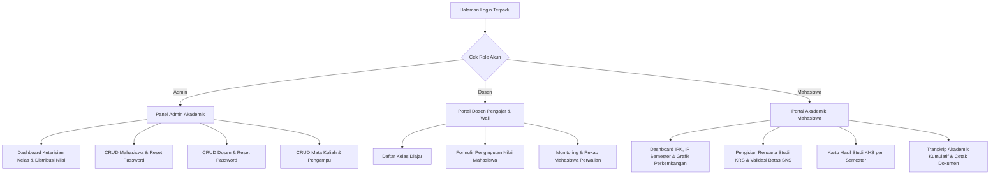
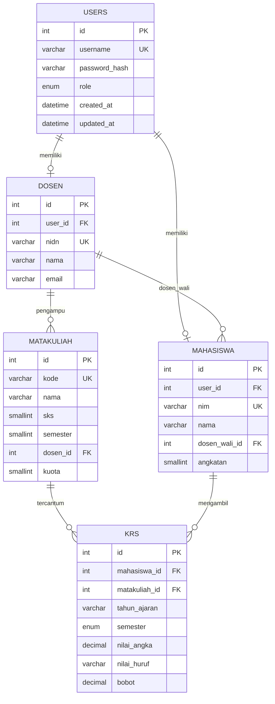
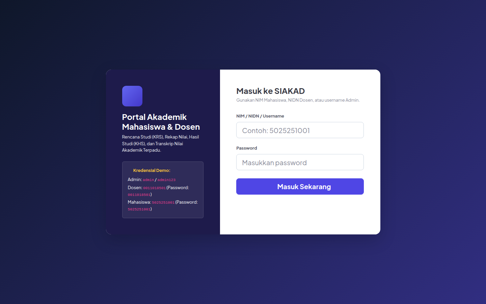
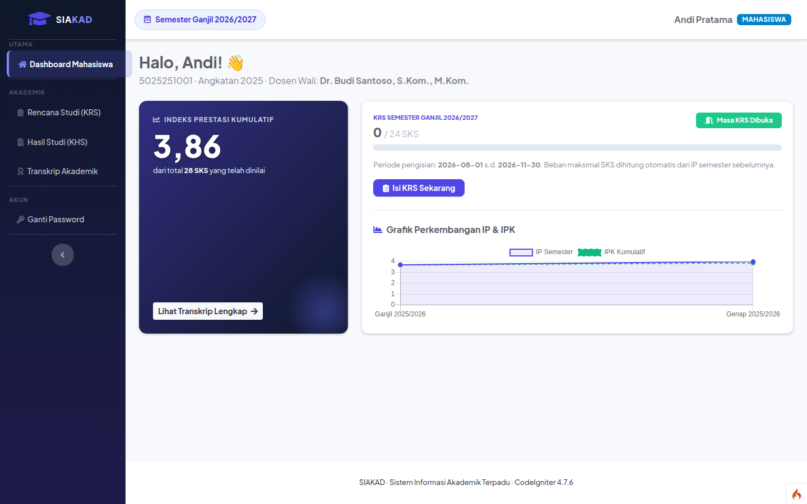
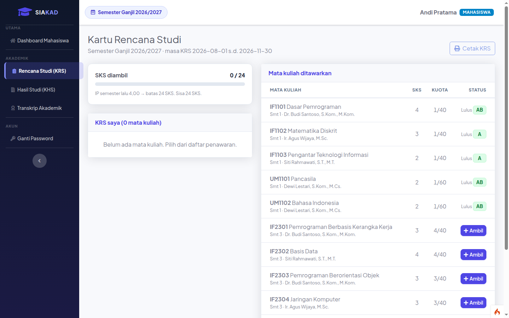
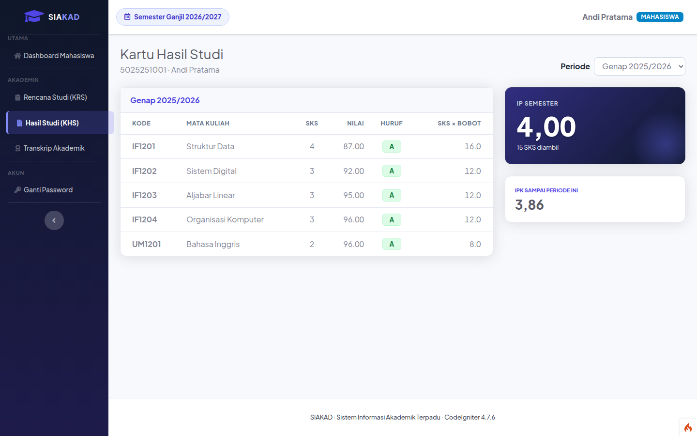

# SIAKAD — Sistem Informasi Akademik Terpadu

**Mata kuliah:** Pemrograman Berbasis Kerangka Kerja (PBKK) · **Nama:** Muhammad Abid Baihaqi Al Faridzi · **NRP:** 5025241133 · **Kelas:** D

## Deskripsi

SIAKAD adalah aplikasi pengelolaan akademik untuk mahasiswa, dosen, dan administrator. Aplikasi mencakup KRS, pengelolaan nilai, KHS, transkrip, dan pengelolaan data akademik.

## Fitur dan hak akses


Aplikasi memiliki kontrol hak akses berbasis peran (**RBAC**) yang membagi kewenangan ke dalam 3 jenis aktor:



### Matriks Fitur:

| Fitur / Modul | Mahasiswa | Dosen | Admin Akademik |
|---|:---:|:---:|:---:|
| **Dashboard Akademik & Statistik** | ✅ IP & IPK Pribadi | ✅ Ringkasan Mengajar | ✅ Keterisian Kelas & Nilai |
| **Pengisian & Pembatalan KRS** | ✅ Ya (Sesuai Periode) | ❌ Tidak | ❌ Tidak |
| **Cetak Kartu Rencana Studi (KRS)** | ✅ Format Cetak Resmi | ❌ Tidak | ❌ Tidak |
| **Input & Koreksi Nilai Perkuliahan** | ❌ Hanya Membaca | ✅ Ya (Kelas Sendiri) | ❌ Tidak |
| **Monitoring Mahasiswa Perwalian** | ❌ Tidak | ✅ Ya (Anak Wali) | ❌ Tidak |
| **Melihat KHS & Transkrip Nilai** | ✅ Ya | ❌ Tidak | ❌ Tidak |
| **Cetak Transkrip Akademik Resmi** | ✅ Ya | ❌ Tidak | ❌ Tidak |
| **Manajemen Data Master Mahasiswa** | ❌ Tidak | ❌ Tidak | ✅ CRUD + Reset Pass |
| **Manajemen Data Master Dosen** | ❌ Tidak | ❌ Tidak | ✅ CRUD + Reset Pass |
| **Manajemen Data Mata Kuliah & Kuota** | ❌ Tidak | ❌ Tidak | ✅ CRUD |
| **Fitur Ubah Password Mandiri** | ✅ Ya | ✅ Ya | ✅ Ya |


### Aturan akademik


1. **Batas Maksimal SKS Dinamis**: Batas SKS yang dapat diambil mahasiswa pada semester berjalan ditentukan secara otomatis berdasarkan Indeks Prestasi (IP) semester sebelumnya:
   * IP >= 3.00 ➔ Maksimal **24 SKS**
   * 2.50 <= IP < 3.00 ➔ Maksimal **21 SKS**
   * 2.00 <= IP < 2.50 ➔ Maksimal **18 SKS**
   * IP < 2.00 ➔ Maksimal **15 SKS**
2. **Validasi Kuota Kelas**: Mahasiswa tidak dapat mengambil mata kuliah jika kuota peserta kelas telah terpenuhi.
3. **Konversi Nilai Otomatis**: Penginputan nilai angka (0 - 100) oleh dosen secara otomatis dikonversi ke nilai huruf dan bobot mutu sesuai standar akademik perguruan tinggi:
   * **A** (86 - 100, Bobot 4.0)
   * **AB** (76 - 85, Bobot 3.5)
   * **B** (66 - 75, Bobot 3.0)
   * **BC** (61 - 65, Bobot 2.5)
   * **C** (56 - 60, Bobot 2.0)
   * **D** (41 - 55, Bobot 1.0)
   * **E** (0 - 40, Bobot 0.0)


## Struktur database





## Akun demo

| Peran | Username | Password |
|---|---|---|
| Admin akademik | `admin` | `admin123` |
| Dosen | `0011018501` | `0011018501` |
| Mahasiswa | `5025251001` | `5025251001` |

Kredensial ini berasal dari data demo dan berlaku jika data akun belum diubah.

## Teknologi dan prasyarat

- PHP 8.2 atau lebih baru dengan ekstensi yang diperlukan CodeIgniter, termasuk `intl`, `mbstring`, `mysqli`, `curl`, dan `xml`.
- Composer dan MySQL; proyek menggunakan CodeIgniter 4 dan Bootstrap.
- Ekstensi `gd` diperlukan untuk fitur pengolahan gambar jika digunakan.

## Instalasi dan menjalankan

1. Buat database MySQL kosong bernama `siakad` dan pastikan pengguna MySQL memiliki akses ke database tersebut.
2. Masuk ke folder `SIAKAD` dan instal dependensi:

   ```bash
   cd "T06_Framework CodeIgniter/SIAKAD"
   composer install
   ```

3. Jika `.env` belum ada, salin `.env.example` menjadi `.env`. Atur koneksi database dan URL sesuai lingkungan lokal; jangan menimpa `.env` yang sudah dikonfigurasi.

   ```ini
   CI_ENVIRONMENT = development
   app.baseURL = 'http://localhost:8081/'
   app.indexPage = ''
   database.default.hostname = 127.0.0.1
   database.default.database = siakad
   database.default.username = USER_MYSQL
   database.default.password = PASSWORD_MYSQL
   database.default.DBDriver = MySQLi
   database.default.port = 3306
   database.default.DBPrefix = ''
   ```

4. Jalankan migrasi dan data demo pada **database baru yang masih kosong**:

   ```bash
   php spark project:setup --seed
   ```

   Untuk database yang sudah berisi data, jalankan `php spark project:setup` tanpa `--seed`. Seeder hanya untuk tabel aplikasi yang kosong.

5. Jalankan aplikasi:

   ```bash
   php spark serve --host 127.0.0.1 --port 8081
   ```

   Buka <http://localhost:8081/> di browser. Hentikan server dengan `Ctrl+C`.

## Pengujian

```bash
php spark routes
vendor/bin/phpunit
```

Jalankan perintah tersebut dari direktori proyek. Sebagian pengujian database mungkin memerlukan konfigurasi dan data MySQL khusus.

## Keamanan

Akses halaman dibatasi melalui filter autentikasi dan peran. Formulir menggunakan perlindungan CSRF, dan password akun disimpan sebagai hash.

## Tampilan aplikasi

### Halaman login



### Dashboard mahasiswa



### Kartu Rencana Studi (KRS)



### Kartu Hasil Studi (KHS)


