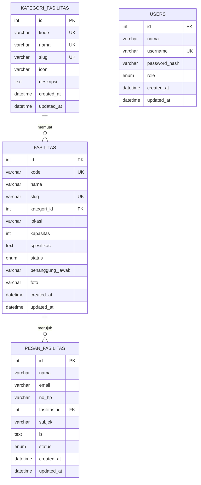
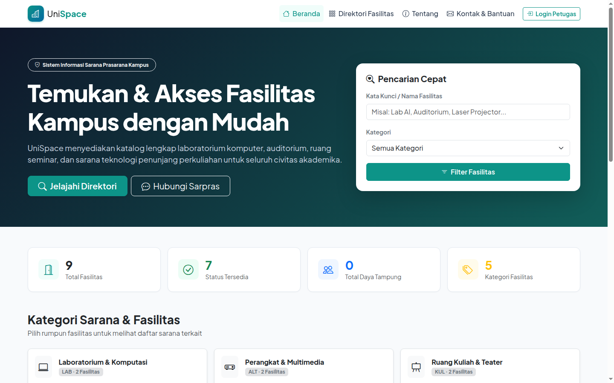
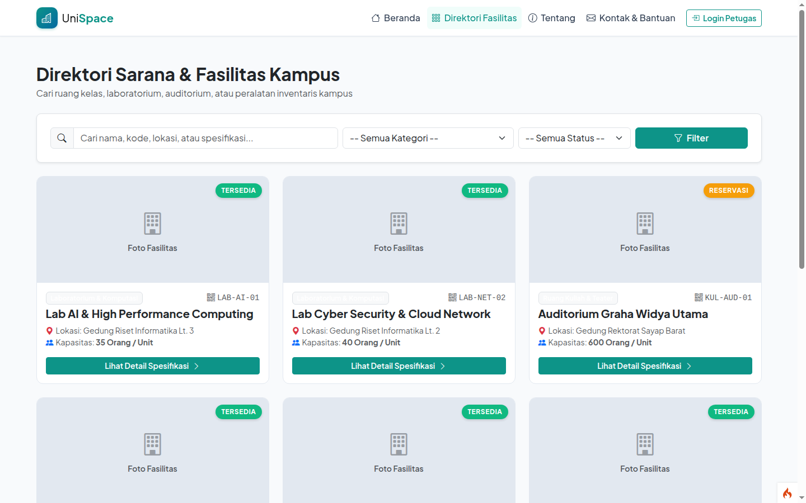
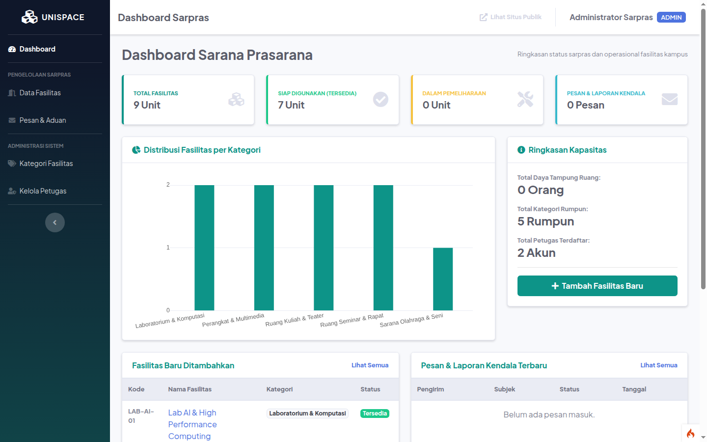
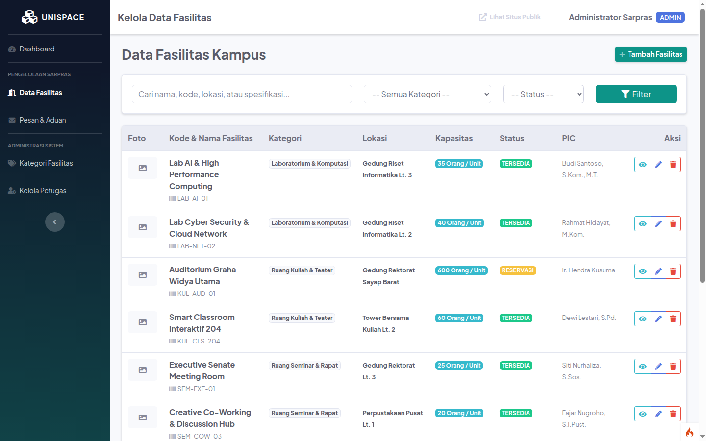

# UniSpace — Smart Campus Facility & Asset Directory

**Mata kuliah:** Pemrograman Berbasis Kerangka Kerja (PBKK) · **Nama:** Muhammad Abid Baihaqi Al Faridzi · **NRP:** 5025241133 · **Kelas:** D

## Deskripsi

UniSpace adalah aplikasi direktori dan manajemen fasilitas kampus. Pengunjung dapat menjelajahi fasilitas dan mengirim pertanyaan atau laporan, sementara petugas mengelola katalog dan pesan melalui panel administrasi.

## Fitur dan hak akses


| Fitur / Aksi | Pengunjung / Civitas | Staff Sarpras | Administrator |
|---|:---:|:---:|:---:|
| **Eksplorasi Katalog & Pencarian Fasilitas** | ✅ Ya | ✅ Ya | ✅ Ya |
| **Filter berdasarkan Kategori & Status** | ✅ Ya | ✅ Ya | ✅ Ya |
| **Melihat Detail Spesifikasi & PIC Fasilitas** | ✅ Ya | ✅ Ya | ✅ Ya |
| **Mengirim Pertanyaan / Aduan Kendala Sarpras** | ✅ Ya | ✅ Ya | ✅ Ya |
| **Akses Dashboard Analitik & Statistik (SB Admin 2)** | ❌ Tidak | ✅ Ya | ✅ Ya |
| **Tambah & Edit Data Fasilitas (Upload Foto)** | ❌ Tidak | ✅ Ya | ✅ Ya |
| **Hapus Data Fasilitas Permanen** | ❌ Tidak | ❌ Tidak | ✅ Ya |
| **Membaca & Update Status Kotak Masuk Pesan** | ❌ Tidak | ✅ Ya | ✅ Ya |
| **Hapus Pesan Masuk** | ❌ Tidak | ❌ Tidak | ✅ Ya |
| **Kelola Kategori Fasilitas (CRUD)** | ❌ Tidak | ❌ Tidak | ✅ Ya |
| **Kelola Akun Petugas Sarpras (CRUD)** | ❌ Tidak | ❌ Tidak | ✅ Ya |


## Struktur database


Aplikasi menggunakan database MySQL relasional dengan 4 tabel utama:



### Penjelasan Tabel:
1. `users`: Menyimpan kredensial petugas sarpras (password di-hash menggunakan algoritma `PASSWORD_DEFAULT`). Role: `admin` dan `staff`.
2. `kategori_fasilitas`: Rumpun klasifikasi fasilitas (`LAB`, `KUL`, `SEM`, `ALT`, `OLA`) dengan auto-generated slug dan icon Bootstrap.
3. `fasilitas`: Entitas utama sarana prasarana. Memiliki foreign key ke `kategori_fasilitas` dengan proteksi `RESTRICT` pada delete agar kategori yang masih memuat fasilitas tidak terhapus sengaja.
4. `pesan_fasilitas`: Formulir kontak civitas akademika untuk pertanyaan maupun pelaporan kendala teknis fasilitas.


## Akun demo

| Peran | Username | Password |
|---|---|---|
| Administrator | `admin` | `admin123` |
| Staff sarpras | `staff` | `staff123` |

Akun tersedia setelah seeder berhasil dijalankan pada database baru.

## Teknologi dan prasyarat

- PHP 8.2 atau lebih baru dengan ekstensi yang diperlukan CodeIgniter, termasuk `intl`, `mbstring`, `mysqli`, `curl`, dan `xml`.
- Composer dan MySQL; proyek menggunakan CodeIgniter 4 dan Bootstrap.
- Ekstensi `gd` diperlukan untuk fitur pengolahan gambar jika digunakan.

## Instalasi dan menjalankan

1. Buat database MySQL kosong bernama `unispace` dan pastikan pengguna MySQL memiliki akses ke database tersebut.
2. Masuk ke folder `UniSpace` dan instal dependensi:

   ```bash
   cd "T06_Framework CodeIgniter/UniSpace"
   composer install
   ```

3. Jika `.env` belum ada, salin `.env.example` menjadi `.env`. Atur koneksi database dan URL sesuai lingkungan lokal; jangan menimpa `.env` yang sudah dikonfigurasi.

   ```ini
   CI_ENVIRONMENT = development
   app.baseURL = 'http://localhost:8080/'
   app.indexPage = ''
   database.default.hostname = 127.0.0.1
   database.default.database = unispace
   database.default.username = USER_MYSQL
   database.default.password = PASSWORD_MYSQL
   database.default.DBDriver = MySQLi
   database.default.port = 3306
   database.default.DBPrefix = ''
   ```

4. Jalankan migrasi dan data demo pada **database baru yang masih kosong**:

   ```bash
   php spark migrate
   php spark db:seed DatabaseSeeder
   ```

   Jangan jalankan seeder berulang kali pada database yang sudah berisi data; migrasi selanjutnya dapat dijalankan dengan `php spark migrate`.

5. Jalankan aplikasi:

   ```bash
   php spark serve --host 127.0.0.1 --port 8080
   ```

   Buka <http://localhost:8080/> di browser. Hentikan server dengan `Ctrl+C`.

## Pengujian

```bash
php spark routes
vendor/bin/phpunit
```

Jalankan perintah tersebut dari direktori proyek. Sebagian pengujian database mungkin memerlukan konfigurasi dan data MySQL khusus.

## Keamanan

- **Proteksi CSRF**: Token CSRF diaktifkan secara global di `Filters.php` dan disertakan di setiap form POST/PUT/DELETE.
- **Output Escaping**: Setiap data dinamis dari database atau input user di-escape menggunakan fungsi bawaan `esc()` untuk mencegah *Cross-Site Scripting (XSS)*.
- **Upload File Hardening**: Validasi MIME type (`image/jpeg`, `image/png`, `image/webp`), batasan ekstensi, batasan ukuran 2MB, dan penyimpanan menggunakan nama acak hash (`getRandomName()`) untuk mencegah eksekusi skrip berbahaya.
- **Role-Based Access Control (RBAC)**: Menggunakan filter `AuthFilter` dan `RoleFilter` di `app/Filters/` untuk mengunci endpoint administratif.

## Tampilan aplikasi

### Beranda



### Direktori fasilitas



### Dashboard administrator



### Pengelolaan fasilitas


