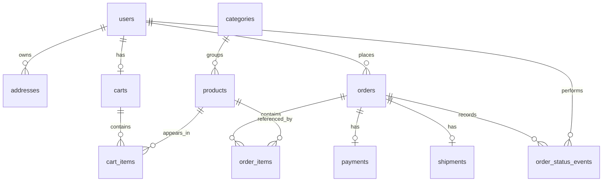
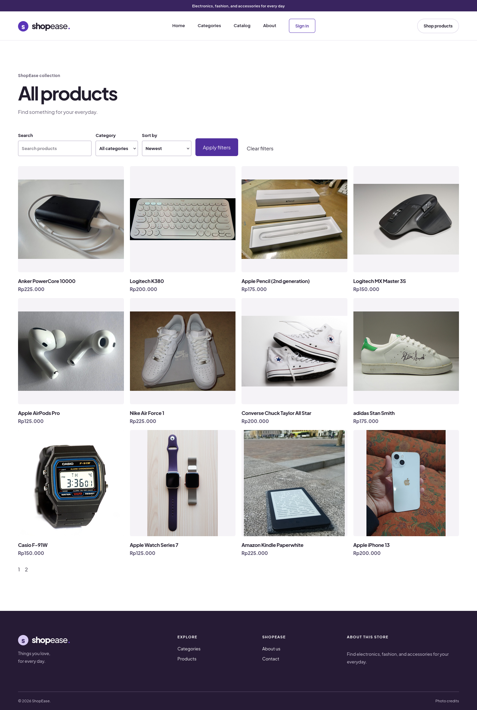
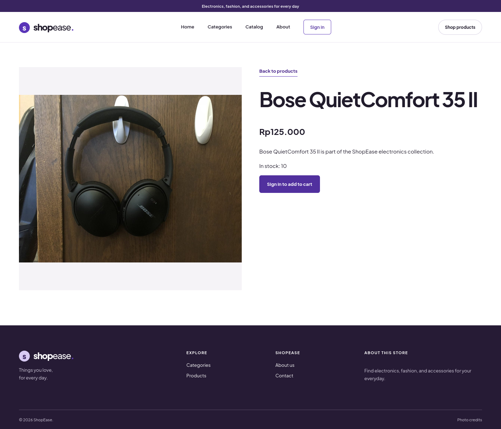
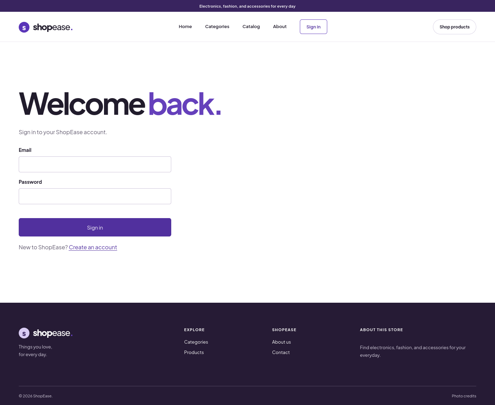
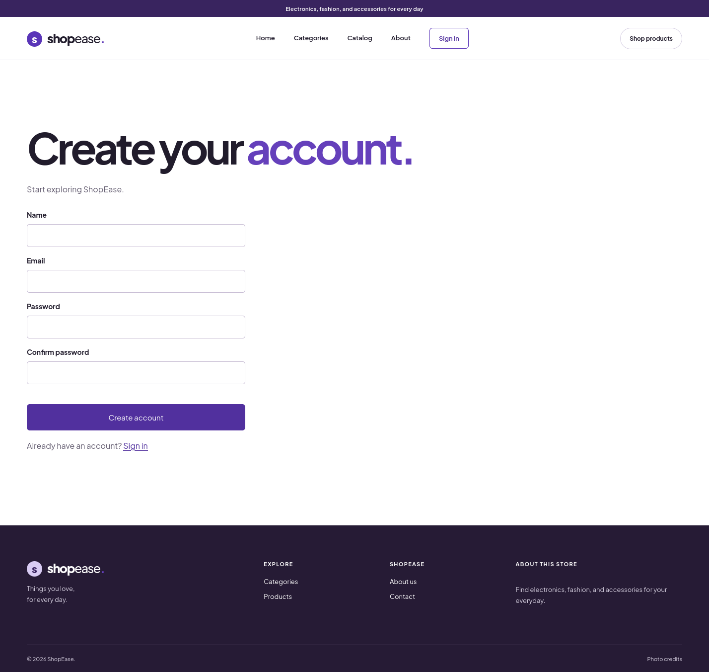
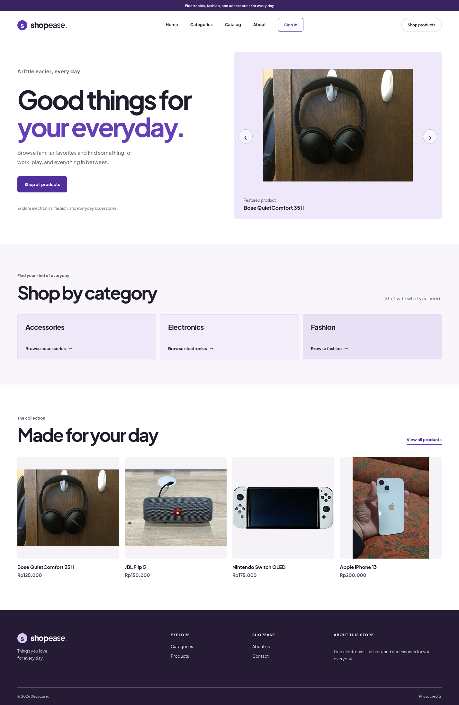

# ShopEase

Nama: Muhammad Abid Baihaqi Al Faridzi

NRP: 5025241133

Prodi: Teknik Informatika

Mata Kuliah: Pemrograman Berbasis Kerangka Kerja

Kelas: D

## Deskripsi

ShopEase adalah aplikasi toko online berbasis CodeIgniter 4 yang menyediakan katalog produk, keranjang, checkout, pembayaran manual, dan pengelolaan pesanan. Pengunjung dapat melihat produk, customer dapat membuat pesanan, sedangkan admin dan operator mengelola proses toko sesuai hak aksesnya.

## Fitur dan hak akses

| Fitur | Pengunjung | Customer | Admin | Operator |
|---|:---:|:---:|:---:|:---:|
| Melihat beranda, katalog, dan detail produk | ✅ | ✅ | ✅ | ✅ |
| Mencari produk, filter kategori, mengurutkan harga | ✅ | ✅ | ✅ | ✅ |
| Registrasi dan login | ✅ | — | — | — |
| Mengelola password akun sendiri | — | ✅ | ✅ | ✅ |
| Keranjang, alamat, checkout, dan pesanan sendiri | — | ✅ | — | — |
| Mengunggah bukti pembayaran pesanan sendiri | — | ✅ | — | — |
| Dashboard, produk, kategori, customer, laporan, dan pengaturan | — | — | ✅ | — |
| Melihat semua pesanan serta memverifikasi pembayaran | — | — | ✅ | — |
| Membatalkan pesanan sebelum pembayaran diverifikasi | — | — | ✅ | — |
| Mengelola pengiriman dan menyelesaikan pesanan | — | — | ✅ | ✅ |

Operator hanya melihat pesanan dengan status `processing`, `shipped`, atau `completed`. Admin dan operator dapat melihat toko publik, tetapi fitur belanja dan checkout dibatasi untuk customer. Role diperiksa pada route dan tindakan yang bersangkutan.

### Rincian fitur

- **Katalog:** hanya menampilkan produk aktif dalam kategori aktif. Tersedia pencarian nama, filter kategori, pengurutan harga, pagination, dan halaman detail produk.
- **Akun:** registrasi customer, login, logout, dan perubahan password. Customer dapat menambahkan dan mengubah alamat, menghapus alamat, serta menetapkan alamat utama.
- **Keranjang:** menambah produk, mengubah jumlah, dan menghapus produk. Harga dan ketersediaan diperiksa kembali; jika harga berubah, customer diminta meninjau dan memperbarui keranjang.
- **Checkout:** customer memilih alamat dan melihat subtotal, ongkir, dan total. Stok dikurangi ketika pesanan dibuat. Checkout tidak tersedia sampai admin mengisi instruksi pembayaran di **Store settings**.
- **Pembayaran:** customer mengunggah bukti, kemudian admin menyetujui atau menolak dengan alasan. Jika ditolak, customer dapat mengunggah ulang bukti.
- **Pesanan dan pengiriman:** customer melihat pesanan miliknya; admin memverifikasi atau membatalkan pesanan yang memenuhi syarat; admin/operator mengisi kurir dan nomor resi serta menandai pesanan selesai.
- **Manajemen:** admin mengelola kategori, produk dan gambarnya, melihat daftar customer, mengatur ongkir serta instruksi pembayaran, dan melihat laporan penjualan berdasarkan rentang tanggal.

## Flow apps    

1. Admin login, membuka **Settings**, lalu mengisi biaya pengiriman dan instruksi pembayaran untuk mengaktifkan checkout. Biaya pengiriman awal adalah Rp0.
2. Customer login, memilih produk, menambahkannya ke keranjang, dan menambahkan alamat.
3. Customer memeriksa keranjang dan membuat pesanan melalui **Checkout**. Status awal pesanan adalah `pending_payment`.
4. Customer mengunggah bukti pembayaran; pesanan berpindah ke `waiting_verification`.
5. Admin memeriksa bukti. Jika disetujui, pesanan menjadi `processing`; jika ditolak, pesanan kembali ke `pending_payment` untuk pengiriman ulang bukti.
6. Admin atau operator memasukkan kurir dan nomor resi untuk mengubah status menjadi `shipped`, lalu menandainya `completed`.

Admin dapat membatalkan pesanan berstatus `pending_payment` atau `waiting_verification`; stok dikembalikan saat pembatalan. Pembatalan setelah verifikasi, refund, pembayaran otomatis, dan pelacakan ekspedisi secara real-time belum tersedia.

## Tampilan aplikasi


### Landing page dan halaman publik

| Halaman | Route | Isi dan interaksi |
|---|---|---|
| Beranda | `/` | Navigasi, hero dengan featured product yang bergeser otomatis dan panah kiri/kanan, kategori, daftar produk, serta footer. |
| Katalog | `/catalog` | Daftar produk dengan pencarian, filter kategori, urutan harga, dan pagination. |
| Detail produk | `/product/{slug}` | Gambar, nama, harga, deskripsi, stok, dan tombol menambah ke keranjang bagi customer yang login. |
| About dan Contact | `/about`, `/contact` | Informasi toko dan halaman kontak. Informasi kontak belum tersedia. |
| Photo credits | `/photo-credits` | Sumber, nama pembuat, dan lisensi foto produk. |
| Autentikasi | `/login`, `/register` | Form login dan pendaftaran customer. |

### Tampilan customer

- **Cart** (`/cart`): daftar produk, harga, jumlah, subtotal, total, serta aksi update dan remove.
- **Addresses** (`/account/addresses`): tambah, ubah, hapus, dan pilih alamat utama.
- **Checkout** (`/checkout`): ringkasan pesanan, pilihan alamat, ongkir, dan konfirmasi pesanan jika pembayaran sudah dikonfigurasi.
- **Orders** (`/orders`): daftar dan detail pesanan, status, petunjuk pembayaran, serta unggah bukti sesuai status pesanan.
- **Account** (`/account`): informasi akun dan form perubahan password.

### Tampilan admin

Panel admin berada di `/admin`. 

| Halaman | Route | Fungsi |
|---|---|---|
| Dashboard | `/admin` | Ringkasan produk, customer, pesanan, penjualan, pembayaran yang perlu diperiksa, dan pesanan terbaru. |
| Orders | `/admin/orders` | Pencarian dan filter pesanan; detail pesanan untuk verifikasi pembayaran, pembatalan, pengiriman, dan penyelesaian sesuai status. |
| Products | `/admin/products` | Pencarian/filter serta penambahan, pengubahan, aktivasi/nonaktif, dan unggah gambar produk. |
| Categories | `/admin/categories` | Pencarian, penambahan, pengubahan, dan aktivasi/nonaktif kategori. |
| Customers | `/admin/customers` | Pencarian dan daftar customer. |
| Reports | `/admin/reports` | Jumlah dan nilai pesanan `processing`, `shipped`, dan `completed` berdasarkan rentang tanggal. |
| Settings | `/admin/settings` | Mengatur ongkir tetap dan instruksi pembayaran. |

### Tampilan operator

Panel operator berada di `/operator/orders`. Operator melihat antrean dan detail pesanan yang sudah masuk proses, lalu dapat mengisi kurir dan nomor resi atau menyelesaikan pengiriman.


## Struktur database

Migrasi membuat tabel berikut dengan MySQL/InnoDB:

| Tabel | Fungsi |
|---|---|
| `users` | Akun, password hash, role, dan status pengguna. |
| `categories`, `products` | Kategori, produk, harga, stok, dan gambar. |
| `carts`, `cart_items` | Keranjang customer, item, jumlah, dan harga saat ditambahkan. |
| `addresses` | Alamat customer dan penanda alamat utama. |
| `orders`, `order_items` | Identitas pesanan, salinan alamat, status, harga, dan rincian item saat checkout. |
| `payments` | Status, bukti pembayaran, alasan penolakan, dan verifikator. |
| `shipments` | Kurir, nomor resi, serta waktu pengiriman dan penyelesaian. |
| `order_status_events` | Riwayat perubahan status dan pengguna yang melakukannya. |
| `settings` | Ongkir, instruksi pembayaran, dan kesiapan checkout. |



## Tech Stack

- **PHP 8.2 atau lebih baru** dan ekstensi CodeIgniter yang diperlukan, termasuk `intl`, `mbstring`, `mysqli`, `curl`, `xml`, dan `fileinfo`.
- **Composer**, untuk memasang dependensi PHP.
- **MySQL/InnoDB**, tersedia secara lokal atau melalui Docker. Aplikasi memakai driver `MySQLi`.
- **Docker Engine** dan akses ke registry image jika memilih opsi Docker.
- Browser modern. Proses PHP harus dapat menulis ke `writable/` dan `public/uploads/products/`.
- CodeIgniter 4.7, PHP, HTML, CSS, dan JavaScript.

Periksa perangkat yang sudah terpasang:

```bash
php -v
php -m
composer --version
mysql --version       # untuk opsi MySQL lokal
docker --version      # untuk opsi Docker
```

## How to Run

Pilih **satu** opsi database: MySQL yang berjalan langsung di komputer atau MySQL di Docker. Pada kedua opsi, PHP/CodeIgniter berjalan di komputer melalui `php spark serve`; hanya database pada opsi kedua yang berada di container.

### 1. Persiapan proyek

Dari direktori repositori, masuk ke proyek dan pasang dependensi:

```bash
cd "T07_MVC Routing CodeIgniter/ShopEase"
composer install
```

Buat `.env` dari contoh hanya jika `.env` belum ada. Jika sudah ada, gunakan file tersebut dan perbarui pengaturan yang diperlukan tanpa menimpanya:

```bash
cp -n .env.example .env
```

File `.env` berisi konfigurasi lokal dan kredensial. Jangan bagikan atau masukkan file tersebut ke repositori. Dua opsi berikut menggunakan database baru bernama `db_shopease`; gunakan nama lain jika sudah dipakai dan sesuaikan konfigurasi.

### 2A. Opsi MySQL lokal

1. Pastikan server MySQL sudah terpasang dan berjalan. Contoh di Linux dengan systemd:

   ```bash
   sudo systemctl start mysql
   sudo systemctl status mysql
   ```

   Nama layanan dapat berbeda, misalnya `mysqld` atau `mariadb`, tergantung instalasi. Pada sistem tanpa systemd, jalankan MySQL menggunakan alat yang disediakan instalasi Anda.

2. Masuk ke MySQL menggunakan akun yang berhak membuat database dan pengguna, misalnya:

   ```bash
   mysql -u root -p
   

3. Di prompt MySQL, buat database dan pengguna khusus. Ganti `GANTI_PASSWORD_LOKAL` dengan password pilihan Anda:

   ```sql
   CREATE DATABASE db_shopease CHARACTER SET utf8mb4 COLLATE utf8mb4_unicode_ci;
   CREATE USER 'shopease'@'localhost' IDENTIFIED BY 'GANTI_PASSWORD_LOKAL';
   CREATE USER 'shopease'@'127.0.0.1' IDENTIFIED BY 'GANTI_PASSWORD_LOKAL';
   GRANT ALL PRIVILEGES ON db_shopease.* TO 'shopease'@'localhost';
   GRANT ALL PRIVILEGES ON db_shopease.* TO 'shopease'@'127.0.0.1';
   EXIT;
   ```

4. Atur `.env` agar cocok dengan server:

   ```ini
   CI_ENVIRONMENT = development
   app.baseURL = 'http://localhost:8080/'
   app.indexPage = ''
   database.default.hostname = 127.0.0.1
   database.default.database = db_shopease
   database.default.username = shopease
   database.default.password = GANTI_PASSWORD_LOKAL
   database.default.DBDriver = MySQLi
   database.default.port = 3306
   ```

5. Uji koneksi menggunakan password yang sama:

   ```bash
   mysql -h 127.0.0.1 -P 3306 -u shopease -p db_shopease
   ```

   Setelah berhasil masuk, jalankan `EXIT;`, lalu lanjutkan ke [migrasi dan menjalankan aplikasi](#3-migrasi-seed-dan-menjalankan-aplikasi).

### 2B. Opsi MySQL melalui Docker

1. Pastikan Docker Engine berjalan dan periksa container serta port yang sudah dipakai:

   ```bash
   docker ps -a
   ```

   Contoh berikut membuat container baru bernama `shopease-mysql` dan memakai port **3307 di komputer** untuk port **3306 di container**. Jika nama atau port tersebut sudah dipakai, pilih yang lain dan sesuaikan perintah serta `.env`. Container MySQL yang sudah tersedia juga dapat digunakan dengan menyesuaikan kredensial, database, dan port-nya.

2. Ganti kedua password contoh, lalu buat dan jalankan container:

   ```bash
   docker run -d \
     --name shopease-mysql \
     --restart unless-stopped \
     -e MYSQL_ROOT_PASSWORD='GANTI_ROOT_PASSWORD' \
     -e MYSQL_DATABASE='db_shopease' \
     -e MYSQL_USER='shopease' \
     -e MYSQL_PASSWORD='GANTI_PASSWORD_DOCKER' \
     -p 127.0.0.1:3307:3306 \
     -v shopease_mysql_data:/var/lib/mysql \
     mysql:8.0
   ```

   Password pada contoh adalah placeholder. Docker membuat named volume agar data tetap tersimpan ketika container dihentikan atau dihapus. Variabel `MYSQL_DATABASE`, `MYSQL_USER`, dan password di atas hanya dipakai saat direktori data MySQL baru diinisialisasi.

3. Tunggu inisialisasi selesai, lalu periksa status dan log:

   ```bash
   docker ps --filter name=shopease-mysql
   docker logs --tail 40 shopease-mysql
   ```

   Uji login dari dalam container dan masukkan `GANTI_PASSWORD_DOCKER` ketika diminta:

   ```bash
   docker exec -it shopease-mysql mysql -u shopease -p db_shopease
   ```

   Jalankan `EXIT;` setelah berhasil. Inisialisasi pertama dapat memerlukan waktu; jika koneksi ditolak, tunggu dan periksa log lagi.

4. Atur `.env` proyek. Karena PHP berjalan di komputer, gunakan alamat `127.0.0.1` dan port host `3307`, bukan nama container:

   ```ini
   CI_ENVIRONMENT = development
   app.baseURL = 'http://localhost:8080/'
   app.indexPage = ''
   database.default.hostname = 127.0.0.1
   database.default.database = db_shopease
   database.default.username = shopease
   database.default.password = GANTI_PASSWORD_DOCKER
   database.default.DBDriver = MySQLi
   database.default.port = 3307
   ```

5. Kelola container bila diperlukan:

   ```bash
   docker stop shopease-mysql
   docker start shopease-mysql
   docker logs --tail 40 shopease-mysql
   ```

### 3. Migrasi, seed, dan menjalankan aplikasi

Pastikan `.env` sesuai dengan opsi database dan database dapat diakses. Dari direktori `ShopEase`, buat tabel:

```bash
php spark migrate
```

Pada **database ShopEase baru yang masih kosong**, jalankan seeder sekali:

```bash
php spark db:seed DatabaseSeeder
```

Seeder membuat kategori, 15 produk, pengaturan awal, serta akun pada tabel [akun awal](#akun-awal). Seeder menolak berjalan jika tabel `users`, `categories`, `products`, atau `settings` sudah berisi data. Untuk database yang sudah digunakan, jangan menjalankan ulang `DatabaseSeeder` atau menghapus data untuk melewati pemeriksaan tersebut.

Jalankan aplikasi:

```bash
php spark serve --host 127.0.0.1 --port 8080
```

Buka <http://localhost:8080/>. Tekan `Ctrl+C` untuk menghentikan server PHP. Jika memilih port lain, sesuaikan juga `app.baseURL` di `.env`. Database Docker dapat tetap berjalan secara terpisah.


## Seeding

Akun tersedia setelah `DatabaseSeeder` berhasil dijalankan pada database kosong. Seluruh akun berikut memakai password **`demo1234`** untuk pengujian lokal.

| Role | Email | Halaman awal setelah login |
|---|---|---|
| Admin | `admin@shopease.test` | `/admin` |
| Operator | `operator@shopease.test` | `/operator/orders` |
| Customer | `customer@shopease.test` | `/` |
| Customer kedua | `customer2@shopease.test` | `/` |


## Struktur proyek dan alur MVC

```text
ShopEase/
├── app/
│   ├── Config/Routes.php        # peta route
│   ├── Controllers/             # request dan logika pengendali
│   ├── Models/                  # akses data
│   ├── Views/                   # halaman publik, customer, admin, operator
│   ├── Services/                # proses bisnis, termasuk perubahan status pesanan
│   ├── Filters/                 # autentikasi dan otorisasi role
│   └── Database/                # migration dan seeder
├── public/                      # document root dan aset frontend
├── writable/                    # log, session, cache, dan bukti pembayaran privat
├── docs/                        # PRD, studi kasus, HOL, dan rancangan
├── .env.example                 # contoh konfigurasi lokal
├── composer.json                # dependensi PHP
└── spark                        # CLI CodeIgniter
```

Ketika browser meminta suatu URL, route di `app/Config/Routes.php` menentukan controller. Controller memproses permintaan dan menggunakan model atau service bila memerlukan data atau aturan bisnis. Hasilnya dikirim ke view untuk dirender menjadi HTML. Filter `auth` dan `role` membatasi route yang memerlukan login atau role tertentu.

## Penyimpanan, keamanan, dan batasan

- Password disimpan sebagai hash; form POST menggunakan CSRF dan data dinamis dirender dengan escaping.
- Gambar produk yang diunggah admin berada di `public/uploads/products/`. Bukti pembayaran disimpan secara privat di `writable/uploads/payment-proofs/` dan diakses melalui route yang memeriksa hak akses. Keduanya menerima JPEG, PNG, atau WebP hingga 2 MB.
- Foto produk bawaan bersumber dari Wikimedia Commons. Kredit dan tautan lisensinya tercantum pada halaman **Photo credits**.
- Untuk deployment, arahkan document root ke `public/`, lindungi `.env` dan `writable/`, gunakan HTTPS, konfigurasikan server agar direktori upload tidak mengeksekusi skrip, dan gunakan `CI_ENVIRONMENT = production`.

### Dokumentasi

**Katalog**



**Detail produk** 



**Login**



**Registrasi**




<!-- **Landing page desktop**



**Landing page mobile**


**About**


**Contact**


**Keranjang belanja**


**Checkout dan pilihan alamat**


**Alamat pengiriman**


**Daftar pesanan**


**Detail pesanan dan unggah bukti pembayaran**


**Dashboard admin**


**Dashboard admin mobile**


**Daftar pesanan**


**Verifikasi pembayaran**


**Detail pesanan dan pengiriman**


**Daftar produk**


**Tambah produk**


**Edit produk**


**Kategori**


**Daftar customer**


**Laporan penjualan**


**Pengaturan toko**


**Antrean pesanan operator**


**Detail pesanan operator**

![Detail pesanan operator](ShopEase/docs/screenshots/operator-order-detail.png -->
